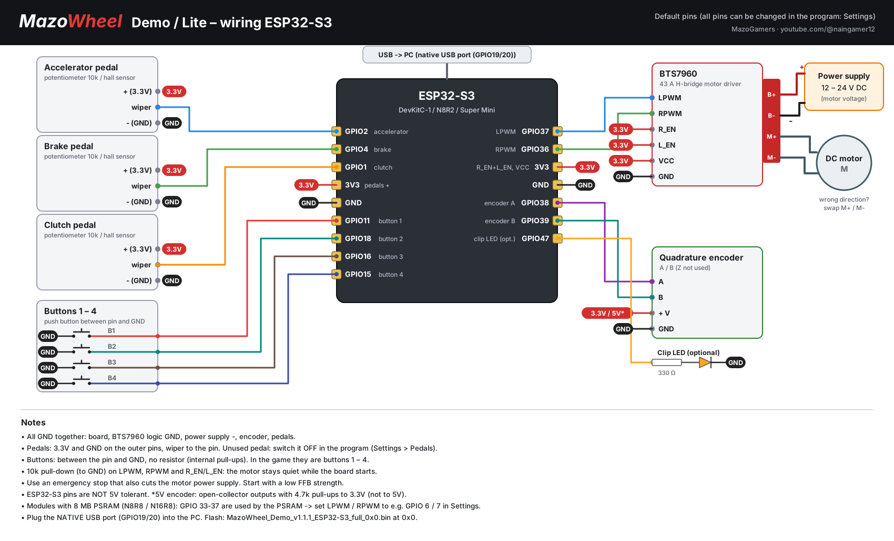
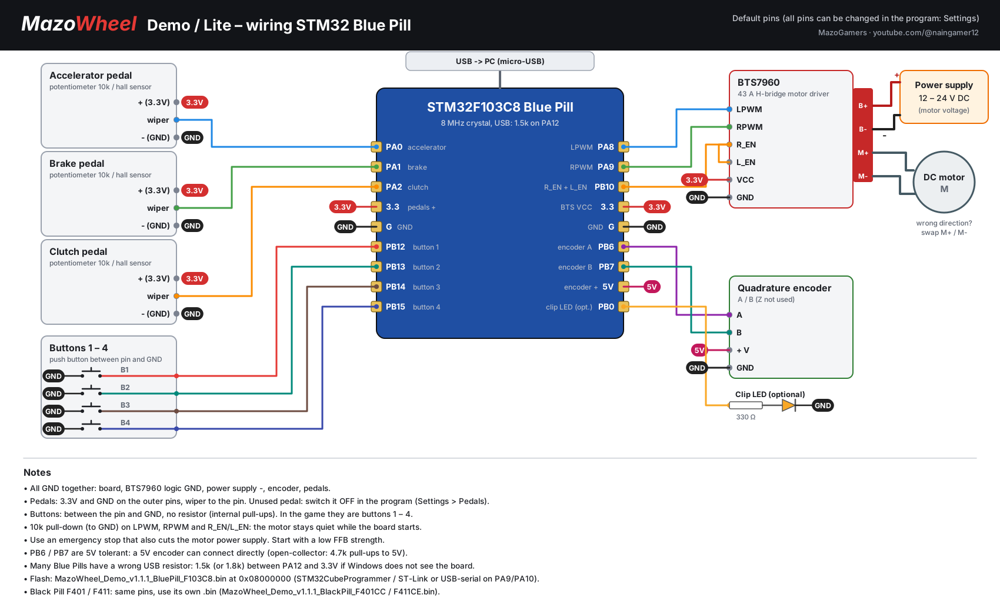
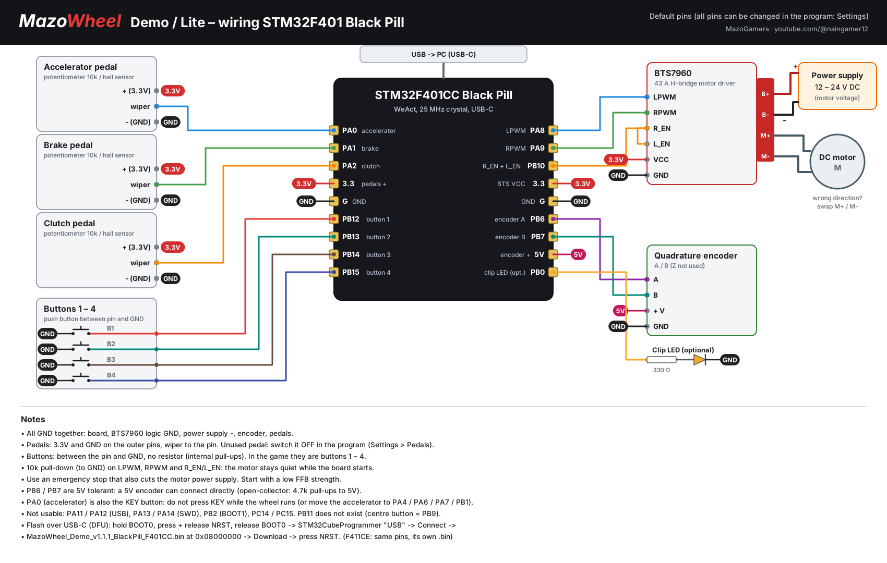
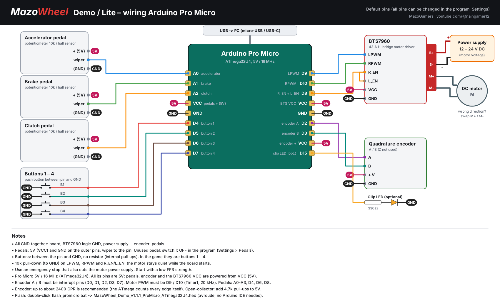

# MazoWheel Lite

**MazoWheel Lite** is a DIY **Force Feedback (FFB) steering wheel** for PC racing simulators, by **MazoGamers**.
It turns a cheap microcontroller board, a DC motor, a motor driver (BTS7960) and an encoder into a real
force feedback wheel that Windows and your games see as a normal **USB game controller**.

This repository contains the **Lite / Demo edition**: ready-to-flash firmware for several boards and the
**MazoWheel Demo** control program for Windows. No license key is needed.

---

## What we built

### Firmware (on the board)
- **USB game controller with force feedback** (HID PID): Windows sees a joystick with FFB, no driver needed
- Steering wheel axis from a **quadrature encoder** (A / B)
- **3 pedals**: accelerator, brake, clutch (analog, potentiometer or hall sensor)
- **4 buttons**
- Game force feedback effects: constant, ramp, sine, square, triangle, sawtooth, spring, damper, inertia, friction
- Built-in **autocenter spring** and **damper** (work even without a game)
- **End stop** at the end of the steering range
- Motor driver output for **BTS7960** (LPWM / RPWM + enable), 20 kHz PWM on the Pro Micro
- Safety: **FFB on / off**, **USB watchdog** (no PC on the USB = no motor force), torque limit
- **All pins are set from the control program** (no recompiling) and saved in the board
- Settings are saved in the board (EEPROM / flash)
- Same serial protocol on every board: one control program for all of them

### MazoWheel Demo control program (Windows)
- Finds and connects to the wheel by itself
- **FFB strength**, **steering angle** (270–1080°), **spring**, **damper**
- **Center steering** button, **FFB on / off**
- Status bar: connection, COM port, board (MCU), status
- **Settings**
  - Buttons: pin of each button with a live lamp
  - Pedals: pin, on / off, invert, **Set Min / Set Max** calibration, live bar
  - Encoder & Motor: encoder **CPR**, encoder pins, motor PWM pins
  - Log
- Checks every pin before saving (wrong pin, pin used twice, pin without ADC ...)
- Settings are written to the wheel automatically

### Lite / Demo limits
| Item | Limit |
|---|---|
| Motor torque | max 40 % |
| Overall FFB gain | max 70 % |
| Damper / friction / inertia / end stop | max 50 % |
| Buttons | 4 |

---

## Supported boards

| Board | Chip | Firmware file | How to flash |
|---|---|---|---|
| **ESP32-S3** (DevKitC-1, N8R2, Super Mini ...) | ESP32-S3 | `MazoWheel_Demo_v1.1.1_ESP32-S3_full_0x0.bin` | esptool, address `0x0` |
| **STM32 Blue Pill** | STM32F103C8 | `MazoWheel_Demo_v1.1.1_BluePill_F103C8.bin` | STM32CubeProgrammer, `0x08000000` |
| **STM32 Black Pill** | STM32F401CC | `MazoWheel_Demo_v1.1.1_BlackPill_F401CC.bin` | STM32CubeProgrammer (USB DFU), `0x08000000` |
| **STM32 Black Pill** | STM32F411CE | `MazoWheel_Demo_v1.1.1_BlackPill_F411CE.bin` | STM32CubeProgrammer (USB DFU), `0x08000000` |
| **STM32F407VE** board | STM32F407VE | `MazoWheel_Demo_v1.1.1_F407VE.bin` | STM32CubeProgrammer, `0x08000000` |
| **Arduino Leonardo** | ATmega32U4 | `MazoWheel_Demo_v1.1.1_ProMicro_ATmega32U4.hex` | `flash_promicro.bat` (avrdude) |
| **Arduino Micro** | ATmega32U4 | `MazoWheel_Demo_v1.1.1_ProMicro_ATmega32U4.hex` | `flash_promicro.bat` (avrdude) |
| **Arduino Pro Micro** 5V / 16 MHz | ATmega32U4 | `MazoWheel_Demo_v1.1.1_ProMicro_ATmega32U4.hex` | `flash_promicro.bat` (avrdude) |

> Only boards with **native USB** work (ESP32-S3, STM32, ATmega32U4).
> Arduino Uno / Nano / Mega and the plain ESP32 / ESP32-C3 can **not** be a USB game controller.

---
## Wiring diagrams

## Wiring diagrams

### ESP32-S3

### STM32 Blue Pill (STM32F103C8)

### STM32 Black Pill (STM32F401 / F411)

### Arduino Leonardo / Micro / Pro Micro (ATmega32U4)
  

## Default pins

All pins can be changed in the program (**Settings**). Wiring diagrams are in the Releases / `docs` folder.

| Function | ESP32-S3 | STM32 Blue / Black Pill | Leonardo / Micro / Pro Micro |
|---|---|---|---|
| Accelerator / Brake / Clutch | GPIO 2 / 4 / 1 | PA0 / PA1 / PA2 | A0 / A1 / A2 |
| Encoder A / B | GPIO 38 / 39 | PB6 / PB7 | D2 / D3 |
| Motor PWM left / right (LPWM / RPWM) | GPIO 37 / 36 | PA8 / PA9 | D9 / D10 |
| BTS7960 R_EN + L_EN | 3.3V | PB10 | D8 |
| Buttons 1–4 | GPIO 11 / 18 / 16 / 15 | PB12 / PB13 / PB14 / PB15 | D4 / D5 / D6 / D7 |

Board notes:
- **ESP32-S3**: 3.3 V only (not 5 V tolerant). On 8 MB PSRAM modules (N8R8 / N16R8) GPIO 33–37 are not usable: move LPWM / RPWM (e.g. to GPIO 6 / 7).
- **STM32**: 3.3 V logic, PB6 / PB7 are 5 V tolerant. Black Pill: PA0 is also the KEY button.
- **ATmega32U4**: 5 V board. Encoder only on interrupt pins D0, D1, D2, D3, D7; motor PWM only on D9 / D10; pedals on A0–A3, D4, D6, D8. Encoder up to about 2400 CPR is recommended.

---

## Hardware you need

- One of the boards above
- DC motor (12–24 V) and a **BTS7960** motor driver
- 12–24 V power supply for the motor
- Quadrature encoder (e.g. 600 PPR = 2400 CPR)
- Pedals: 10k potentiometers or hall sensors
- 4 push buttons
- Recommended: emergency stop switch that also cuts the motor power, 10k pull-downs on LPWM / RPWM / EN, capacitors on the motor supply

---

## Installation

1. Download the firmware for your board and the **MazoWheel Demo** program from the **Releases** section.
2. Flash the firmware:
   - **ESP32-S3**: `esptool --chip esp32s3 --port COM5 write-flash 0x0 MazoWheel_Demo_v1.1.1_ESP32-S3_full_0x0.bin`
     (flash through the UART USB port, then plug the **native USB** port into the PC)
   - **STM32**: STM32CubeProgrammer, write the `.bin` at `0x08000000`
   - **Leonardo / Micro / Pro Micro**: double-click `flash_promicro.bat`, type the board's COM port
     (or press Enter and reset the board twice quickly). No Arduino IDE needed.
3. Wire the motor driver, encoder, pedals and buttons (see the wiring diagram of your board).
4. Connect the wheel to the PC with USB.
5. Open **MazoWheelDemo.exe** (Windows 10 / 11, .NET Framework 4.8). It connects by itself.
6. Set the encoder CPR, the steering angle and calibrate the pedals in **Settings**. Start with a low FFB strength.

---

## Safety

A force feedback motor is strong. Keep your hands off the wheel when it powers up, start with a low FFB strength,
use a common GND for all parts and an emergency stop that also cuts the motor power supply.

---

## Contact

- E-mail: daag78@gmail.com
- YouTube: https://www.youtube.com/@naingamer12
- Facebook: https://www.facebook.com/profile.php?id=100088311560103

---

Developed by **MazoGamers**.
Built on open-source force feedback wheel code (Tero Loimuneva, Saku Kekkonen, Etienne Saint-Paul, Fernando Igor, Milos Rankovic) and TinyUSB.
The Pro Micro flasher uses AVRDUDE (GPL-2.0).
